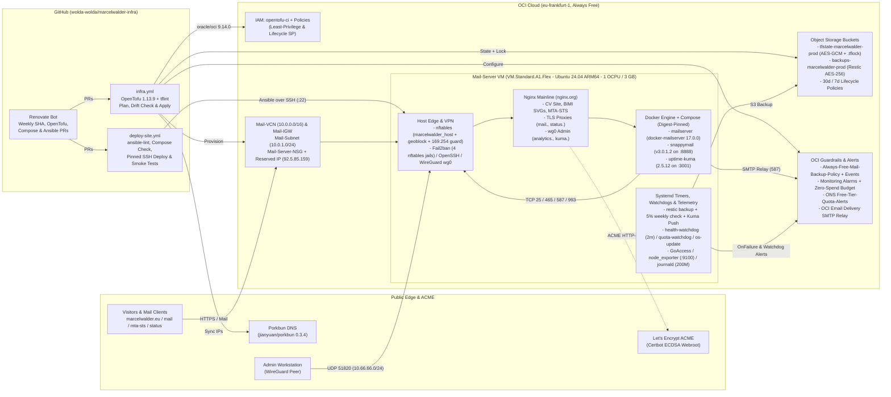

# marcelwalder-infra

Monorepo managing OCI cloud infrastructure, Porkbun DNS, server configuration, and the static CV site at [`marcelwalder.eu`](https://marcelwalder.eu/).

## Repository Structure

```text
marcelwalder-infra/
├── .github/workflows/
│   ├── infra.yml           # OpenTofu fmt, tflint, validate, weekly drift plan, PR plan comment, and gated apply
│   └── deploy-site.yml     # Self-hosted/CSP/Compose/ansible-lint guard, pinned-SSH Ansible deploy + smoke check
├── docs/
│   └── DR-RUNBOOK.md       # Backup verification, cold-start VM rebuild, and opentofu-ci rotation runbook
├── infra/
│   ├── modules/
│   │   ├── network/        # VCN, IGW, default route/security list, subnets, composable NSGs
│   │   ├── compute/        # Map-driven OCI VM instances + optional reserved public IPs
│   │   └── dns/            # Porkbun DNS record module
│   └── live/
│       ├── prod/           # Primary OCI stack (VCN, NSG, VM, versioned+lifecycle buckets, backup policy, Email Delivery, alarms, ONS, budget, least-privilege CI IAM)
│       └── dns/            # Porkbun DNS stack (consumes prod public IPs via remote state)
├── ansible/
│   ├── inventory/hosts.yml
│   ├── roles/              # Modular roles: base_os, firewall, ssh_wireguard, mail_stack, monitoring_backups
│   ├── files/
│   │   ├── mailserver/     # Docker-Mailserver & SnappyMail compose manifests and mail configs
│   │   ├── nginx/          # Hardened Nginx main config, snippets, ACME bootstrap template, and site vhosts
│   │   └── web/            # BIMI SVG assets and MTA-STS policy
│   └── playbooks/
│       ├── site.yml        # Multi-domain ACME bootstrap, sync site/, BIMI/MTA-STS assets, Nginx vhosts
│       ├── harden.yml      # Role-based VM hardening (native nftables, Fail2ban, WireGuard, mail, monitoring, Restic)
│       └── restore.yml     # Cold-start Restic S3 restore of /etc/letsencrypt, mail, SnappyMail, Kuma, and WireGuard
└── site/                   # Self-hosted static CV bundle (zero external font/avatar requests)
```

## Architecture Overview



## Complete Tech Stack Reference

### 1. Containers & Mail/Monitoring Runtime (Docker Engine + Compose)

All production containers run under Docker Engine with JSON log rotation (`max-size: 10m`, `max-file: 3`) configured in `/etc/docker/daemon.json` and pinned by tag + SHA256 digest:

| Service / Container | Pinned Image / Version | Ports / Bind | Purpose & Key Components |
| --- | --- | --- | --- |
| `mailserver` | `ghcr.io/docker-mailserver/docker-mailserver:17.0.0` (`sha256:6cd2d4db...`) | Public TCP `25`, `465`, `587`, `993` | Full mail server (`Postfix`, `Dovecot`, `Rspamd`, `ManageSieve`, internal `Fail2ban`, `MTA-STS`), outbound relay via OCI Email Delivery (`smtp.email.eu-frankfurt-1.oci.oraclecloud.com:587`), `pids_limit: 512` |
| `snappymail` | `djmaze/snappymail:v3.0.1.2` (`sha256:e2fa8e4f...`) | `127.0.0.1:8888` | Webmail UI behind `mail.marcelwalder.eu`, `mem_limit: 256m`, `pids_limit: 128`, `cap_drop: ALL` + `no-new-privileges`, `allow_admin_panel = Off`, Alpine `nginx`/`libpq`/`libecpg` kept patched |
| `uptime-kuma` | `louislam/uptime-kuma:2.5.12` (`sha256:8e4b6bef...`) | `127.0.0.1:3001` | Public `/status/prod` status page (`status.marcelwalder.eu`), internal admin UI over `wg0`, SQLite state (`/opt/uptime-kuma/data/kuma.db`), SMTP email alerting & `Restic Offsite Backup` Push monitor, `mem_limit: 256m` |

### 2. Host OS, Web Server, Security & CLI Packages (`Mail-Server`)

Runs on **Oracle Cloud Always Free `VM.Standard.A1.Flex`** (`1 OCPU`, `3 GB RAM`, `50 GB` boot volume, **Ubuntu 24.04 Noble ARM64**):

| Component / Package | Role & Configuration |
| --- | --- |
| **Nginx (mainline, `nginx.org`)** | Installed from official `https://nginx.org/packages/mainline/ubuntu noble` repo (GPG key verified against `573BFD6B3D8FBC641079A6ABABF5BD827BD9BF62`). Serves `marcelwalder.eu`, `www` redirect, BIMI SVGs (`/var/www/mail`), MTA-STS policy (`/var/www/mta-sts`), HTTPS reverse proxies (`mail.`, `status.`), default catch-all `444` dropper, CSP/HSTS/bot-filter snippets, and `wg0`-only vhosts (`analytics.`, `kuma.`). |
| **Certbot + `python3-certbot-nginx`** | Issues/renews Let's Encrypt ECDSA certificates (`--webroot`) for all 4 domains (`marcelwalder.eu`, `mail.marcelwalder.eu`, `mta-sts.marcelwalder.eu`, `status.marcelwalder.eu`) + `/etc/letsencrypt/renewal-hooks/deploy/reload-mailserver.sh`. |
| **`nftables`** | Native host firewall (`table inet marcelwalder_host` in `/etc/nftables.conf`), OCI `169.254.0.0/16` metadata output guard (`instance_services`), and country geoblocking (`table inet marcelwalder_geoblock`) while preserving Docker `iptables-nft` chains. |
| **Fail2ban (+ `python3-systemd`)** | Active intrusion prevention across 4 jails (`sshd`, `nginx-botsearch`, `nginx-limit-req`, `nginx-probe-drop`) using `banaction = nftables[type=multiport]`. |
| **OpenSSH (`sshd`)** | Key-only authentication hardened via `/etc/ssh/sshd_config.d/50-marcelwalder-hardening.conf` and `PasswordAuthentication no`. |
| **WireGuard (`wireguard-tools`, `wg0`)** | Admin VPN mesh (`10.66.66.1/24` on UDP `51820`) protecting `analytics.marcelwalder.eu` (`10.66.66.1:8085`), `kuma.marcelwalder.eu` (`10.66.66.1:8086`), and `/metrics`. |
| **Restic** | Daily AES-256 encrypted backups to OCI S3 (`backups-marcelwalder-prod`) + weekly `restic check --read-data-subset=5%` + cold-start recovery playbook ([restore.yml](ansible/playbooks/restore.yml)). |
| **GoAccess** | Generates HTML Nginx log analytics into `/var/www/internal/goaccess` (`wg0`-only). |
| **Prometheus Node Exporter** | Exposes host telemetry on `127.0.0.1:9100`, proxied at `analytics.marcelwalder.eu/metrics` over `wg0`. |
| **`unattended-upgrades`** | Daily security-only APT upgrades (`20auto-upgrades`, `50unattended-upgrades`; blacklists `docker-ce*`, `containerd.io`, `nginx*`; `Automatic-Reboot "false"`). |
| **`systemd-journald`** | Log retention capped via `/etc/systemd/journald.conf.d/99-marcelwalder-journald.conf` (`SystemMaxUse=200M`, `MaxRetentionSec=30day`). |
| **Host CLI / Runtime Tools** | `python3` (`send-alert.py`, `mail-avatar.py` BIMI tool, Kuma SQLite sync), `bash`, `curl`, `rsync`, `gnupg`, `ca-certificates`, `openssl` (DH params), `logrotate`. |

### 3. Host Systemd Services & Timers

All scheduled jobs run under `systemd` with `OnFailure=marcelwalder-alert@%n.service` (`systemd-alert.sh` → `marcelwalder-send-alert` over OCI Email Delivery):

| Unit / Timer | Script / Action | Purpose |
| --- | --- | --- |
| `marcelwalder-restic-backup.{service,timer}` | `restic-backup.sh` | Daily encrypted S3 backup + Uptime Kuma Push heartbeat (`restic-heartbeat.url`) |
| `marcelwalder-restic-check.{service,timer}` | `restic check --read-data-subset=5%` | Weekly repository metadata & 5% data pack integrity scrub |
| `marcelwalder-healthcheck.{service,timer}` | `health-watchdog.sh` | Every-2-minute check & self-healing of Nginx, Docker stacks, `wg0`, `nftables`, disk/TLS |
| `marcelwalder-geoblock.service` & `marcelwalder-geoblock-update.{service,timer}` | `update-geoblock.sh` | Boot restore + weekly country CIDR refresh (`geoblock.conf`) for `nftables` & Nginx geo |
| `marcelwalder-goaccess.{service,timer}` | `goaccess-update.sh` | Periodic Nginx log parsing for internal analytics report |
| `marcelwalder-os-update.{service,timer}` | `mailserver-update.sh` | Weekly APT package updates, Nginx/Fail2ban hygiene & health check |
| `marcelwalder-quota-watchdog.{service,timer}` | `quota-watchdog.sh` | Checks monthly OCI Email Delivery relay usage (`3,000` free cap, 70%/90% alerts) & disk |
| `marcelwalder-alert@.service` | `systemd-alert.sh` + `send-alert.py` | Instant email alert when any monitored unit fails |

### 4. Cloud Infrastructure, IaC, CI/CD & Frontend Tooling

| Layer | Tools, Versions & Providers | Purpose |
| --- | --- | --- |
| **IaC Engine & Linting** | `OpenTofu` (`>= 1.10.0`, CI pinned `1.13.9`), `TFLint` (`setup-tflint v6`) | Provisions OCI & DNS with client-side `aes_gcm` + `pbkdf2` state/plan encryption, S3 `use_lockfile = true`, committed `.terraform.lock.hcl`, and Monday `05:00 UTC` drift checks |
| **Terraform / OpenTofu Providers** | `oracle/oci 9.14.0`, `jianyuan/porkbun 0.3.4` | OCI VCN/IGW/Subnet/`Mail-Server-NSG`, `Mail-Server` VM + Reserved IP, versioned+lifecycle S3 buckets, Volume Backup Policy, Email Delivery + DKIM, ONS, Events, Alarms, Budget, `opentofu-ci` IAM, and Porkbun DNS sync |
| **Configuration Management** | `Ansible` (`ansible-core==2.22.0`), `ansible-lint==26.11.0` (`profile: production`), `ansible.posix==2.2.2`, `Python 3.13` | Role-based provisioning (`site.yml`, `harden.yml`, `restore.yml`), pinned SSH host verification (`ansible/files/ssh/known_hosts`), `site/`-only fast-path deploys |
| **CI/CD Pipelines** | `GitHub Actions` (`actions/checkout v7`, `actions/setup-python v7`, `opentofu/setup-opentofu v2`, `terraform-linters/setup-tflint v6`, `actions/github-script v9`) | PR/push compliance checks (`docker compose config -q`, `python3 -m json.tool`, `py_compile`, `bash -n`, `ansible-lint`, `tflint`, CSP/external-asset checks) and post-deploy `curl` smoke tests |
| **Dependency Automation** | `Renovate` (Community App, `renovate.json`) | Weekly (`before 6am on monday`, `Europe/Vienna`, 3-day `minimumReleaseAge`) PRs for GitHub Actions SHA pins, OpenTofu CLI/providers (`registry.opentofu.org`), Docker Compose digests, and Ansible packages |
| **Static CV Frontend (`site/`)** | Vanilla `HTML5`, `CSS3`, `JavaScript` (`app.js`, `theme-init.js`), self-hosted `WOFF2` fonts & `SVG` icons | Zero third-party font/avatar/script requests, paired with strict `CSP`, `robots.txt`, and `.well-known/security.txt` |

## Architecture Highlights

- **OpenTofu + OCI Object Storage Backend:** State is stored in private, versioned OCI Object Storage (`tfstate-marcelwalder-prod`, `eu-frankfurt-1`, `prevent_destroy = true`) with native S3 lockfiles (`use_lockfile = true`), bucket object lifecycle expiration (30-day non-current versions, 7-day aborted multipart uploads), committed multi-platform `.terraform.lock.hcl` files, weekly drift detection, and **client-side AES-GCM encryption** (`encryption.tf`).
- **Complete OCI Operational Guardrails:** `infra/live/prod` manages the `backups-marcelwalder-prod` and `tfstate-marcelwalder-prod` buckets (with lifecycle policies), `Mail-Server-NSG` per-instance firewalling, `Always-Free-Mail-Backup-Policy`, OCI Email Delivery (`marcelwalder.eu` domain, `dkim1`, approved senders), `Free-Tier-Quota-Alerts` ONS topic/subscription, modern `condition_details` backup completion events, Always Free down/idle-reclaim monitoring alarms, `Zero-Spend-Guard` budget/alert rules, and least-privilege `opentofu-ci` IAM user/group/policy.
- **Native `nftables` & All-Systemd Automation:** Host firewalling and Fail2ban (`banaction = nftables[type=multiport]`) run natively on `nftables` alongside country geoblocking (`marcelwalder_geoblock`) while preserving Docker `iptables-nft` chains and the Oracle `169.254.0.0/16` metadata guard. All scheduled jobs (OS patching, relay quota watchdog, daily encrypted Restic S3 backup + Uptime Kuma Push dead-man's switch, weekly `restic check --read-data-subset=5%`, geoblock refresh, GoAccess reports, and 2-minute self-healing watchdog) run as systemd timers with `OnFailure=` email alerts and capped `journald` storage (`SystemMaxUse=200M`).
- **Extensible Multi-VM Compute & DR Ready:** `infra/live/prod/topology.auto.tfvars` defines `instances` as a map. Cold-start rebuilds use `ansible/playbooks/restore.yml` + `harden.yml` + `site.yml` per [docs/DR-RUNBOOK.md](docs/DR-RUNBOOK.md).
- **Automated DNS Sync:** `infra/live/dns` reads `instance_public_ips` directly from `prod/terraform.tfstate` via `terraform_remote_state` and includes `imports.tf` for existing `marcelwalder.eu` records (`ha.marcelwalder.eu` is intentionally managed by a separate Home Assistant repository).
- **Strict GitOps & Automated Dependency Updates:** Container images (`docker-mailserver`, `snappymail`, `uptime-kuma`) are pinned to explicit versions and SHA256 digests in `ansible/files/` and reconciled by Ansible on deploy. [renovate.json](renovate.json) tracks weekly updates for GitHub Actions SHA pins, OpenTofu CLI/providers (against `registry.opentofu.org`), and Docker Compose digests.
- **Unattended Host Patching & Compliance CI:** `base_os` configures daily security-only `unattended-upgrades` (`ansible/files/apt/`, blacklisting `docker-ce*`, `containerd.io`, and `nginx*` from background restarts and keeping `Automatic-Reboot "false"`), paired with weekly `marcelwalder-os-update.timer` patching. PRs run `ansible-lint`, `tflint`, Compose validation, and asset/CSP checks; deploys pin the VM SSH key via `ansible/files/ssh/known_hosts` and skip `harden.yml` on `site/`-only updates.
- **4-Layer Failure Alerting + Dead-Man's Switch:** Real-time inbox alerts via direct OCI Email Delivery (`marcelwalder-send-alert`) from (1) Uptime Kuma SMTP notifications + backup Push heartbeat monitor, (2) a 2-minute self-healing host watchdog (`marcelwalder-healthcheck.timer`), (3) systemd `OnFailure=marcelwalder-alert@%n.service` hooks across all scheduled timers, and (4) OCI Cloud Monitoring (`Always-Free-Instance-Down-Guard`) when the VM itself is unreachable.

## Required GitHub Actions Secrets

Configure these in **Settings → Secrets and variables → Actions** (and optionally require manual reviewer approval on a `production` Environment):

| Secret | Used For |
| --- | --- |
| `OCI_S3_ACCESS_KEY_ID` | OCI Customer Secret Key ID for OpenTofu S3 state backend |
| `OCI_S3_SECRET_ACCESS_KEY` | OCI Customer Secret Key secret for OpenTofu S3 state backend |
| `TOFU_STATE_PASSPHRASE` | Client-side AES-GCM passphrase for state & plan encryption |
| `OCI_COMPARTMENT_OCID` | OCI Compartment / Tenancy OCID (`TF_VAR_compartment_id`) |
| `OCI_TENANCY_OCID` | OCI Tenancy OCID for provider auth |
| `OCI_USER_OCID` | OCI IAM User OCID for provider auth |
| `OCI_FINGERPRINT` | OCI API Key fingerprint |
| `OCI_PRIVATE_KEY_PEM` | Private PEM contents of the OCI API key |
| `VM_SSH_AUTHORIZED_KEYS_JSON` | JSON list of SSH public keys, e.g. `["ssh-ed25519 AAAA..."]` |
| `PORKBUN_API_KEY` | Porkbun API key (`pk1_...`) for `infra/live/dns` |
| `PORKBUN_SECRET_KEY` | Porkbun Secret API key (`sk1_...`) for `infra/live/dns` |
| `DEPLOY_SSH_PRIVATE_KEY` | SSH private key for Ansible deployments (`ubuntu` user) |
| `MAIL_SERVER_HOST` | Public IP or hostname of `Mail-Server` (`92.5.85.159`) |

## Adding a Second VM Later

1. Add a new key (e.g., `app = { ... }`) to `instances` in `infra/live/prod/topology.auto.tfvars` and any needed NSG rules in `nsgs`.
2. Optionally add a DNS record in `infra/live/dns/main.tf` referencing `data.terraform_remote_state.prod.outputs.instance_public_ips["app"]`.
3. Open a Pull Request to inspect the OpenTofu plan comment before merging to `main`.
4. Add the new host to `ansible/inventory/hosts.yml` and run `ansible-playbook playbooks/harden.yml -e target_hosts=app_hosts`.
